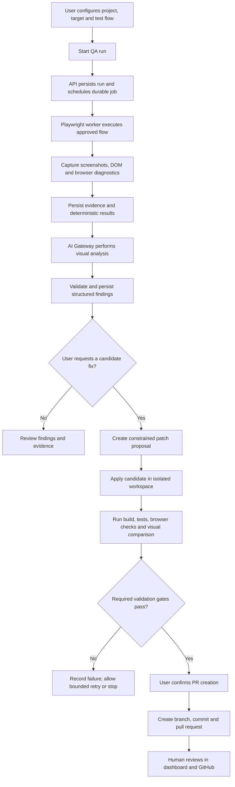
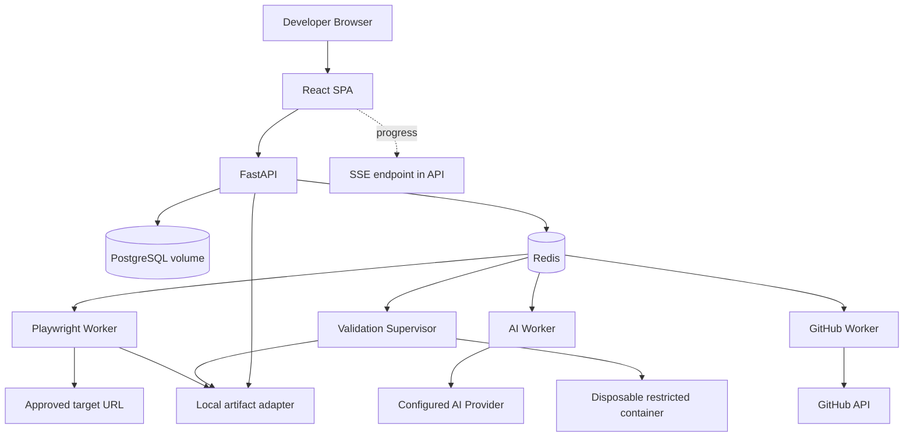

# OmniSight — High-Level Design (HLD)

> **Document ID:** `02-HLD`  
> **Status:** Proposed architecture baseline for review  
> **Last updated:** 2026-10-13  
> **Depends on:** `00-MASTER-CONTEXT.md`, `01-PRODUCT-REQUIREMENTS.md`  
> **Audience:** Project owner, Claude Code, frontend/backend/AI/QA implementers  
> **Purpose:** Define system boundaries, major components, architecture decisions, trust boundaries, principal data flows, deployment shape, and high-level operational behavior. Detailed class designs, endpoint payloads, database columns, and prompts belong in `03-LLD.md` and the domain specifications.

---

## 1. Executive Summary

OmniSight is a web application for multimodal, evidence-driven UI quality assurance and controlled self-healing. It runs configured browser flows against an explicitly authorized web target, captures screenshots and browser evidence, uses deterministic checks and a Vision-Language Model (VLM) to identify candidate defects, helps generate a constrained source-code patch, validates the patch in an isolated workspace, and prepares a GitHub pull request for human review.

The product is a **traceable QA workflow**, not an unrestricted autonomous coding agent. A language model may propose findings and patches, but application code owns permissions, state transitions, validation policy, and remote write authorization. A model response by itself can never establish that a defect was fixed.

### 1.1 Architecture at a glance

- **Frontend:** React + TypeScript + Vite + Tailwind CSS single-page application.
- **API/control plane:** Python + FastAPI; validates user actions, returns resource state, and coordinates work.
- **Durable state:** PostgreSQL is the system of record for projects, flows, runs, findings, patch attempts, validation reports, integration metadata, and workflow history.
- **Asynchronous execution:** Celery workers with Redis as broker; distinct queues/process roles for browser runs, AI analysis, patch validation, and GitHub operations. The database remains the source of truth; tasks must be idempotent and recoverable.
- **Browser automation:** Python Playwright worker for approved navigation, test execution, screenshots, DOM/element evidence, and deterministic assertions.
- **AI Gateway:** Provider-neutral application service with separate visual-analysis and code-patch capabilities. Exact providers/models are configured in a later decision and must not leak into product-domain logic.
- **Patch validation:** Disposable, resource-limited sandbox workspace. Candidate repository code is treated as untrusted executable input.
- **Artifacts:** Object-storage abstraction for screenshots, traces, DOM snapshots, logs, and reports; local disk is acceptable for local development, but production deployment should use private object storage.
- **GitHub:** Dedicated integration component prepares a branch, commits the validated candidate, opens a PR, and reconciles outcomes. No default merge or deployment.
- **Progress updates:** REST for commands and resource reads; Server-Sent Events (SSE) for run/job progress, with REST polling as a fallback.
- **Deployment:** Docker Compose for repeatable local development and the first controlled demonstration; container boundaries should make a later split into managed services possible.

### 1.2 Core end-to-end flow



This diagram represents the product workflow. Each stage must be represented in persistent state, with explicit start/end outcome, timestamps, error classification where relevant, and links to available evidence.

---

## 2. Architecture Goals and Constraints

### 2.1 Primary goals

1. **Complete vertical workflow:** support one reliable path from project configuration to evidence-backed finding, isolated patch validation, and a reviewable GitHub PR.
2. **Evidence traceability:** any displayed finding or validation claim must point back to the run, flow version, target, viewport, evidence, candidate patch, and validation attempt that support it.
3. **Hard boundaries around untrusted execution:** web pages, repository files, package install scripts, test scripts, AI outputs, and webhooks are not trusted instructions.
4. **Asynchronous execution:** browser sessions, model calls, builds, test commands, and GitHub operations must not be held inside a single user-facing request/response cycle.
5. **Provider flexibility:** model vendors should be swappable behind a stable internal interface.
6. **Truthful state:** the application must distinguish passed, failed, skipped, timed out, canceled, inconclusive, and unavailable outcomes.
7. **Reviewable source changes:** every candidate patch is tied to a known repository base revision and validated in an isolated workspace before it becomes eligible for a normal PR workflow.
8. **Practical implementation:** boundaries should be clear and testable without prematurely splitting a small V1 into many independently deployed microservices.

### 2.2 Constraints inherited from the product documents

- The source brief explicitly calls for Playwright with Python, screenshots and DOM context, a VLM, a Plan → Execute → Evaluate loop, FastAPI webhook integration, GitHub branch/commit/PR operations, and a dashboard for review.
- Model and framework names in the source brief are examples, not hard mandates.
- The first demonstrable target is a controlled React-oriented test application with an intentional visual defect, such as a mobile checkout button clipped outside the viewport.
- A valid AI response is not equivalent to a validated fix.
- The default product does not merge or deploy changes.
- Browser targets and repository code must be explicitly authorized and handled under strict execution boundaries.
- The user-facing dashboard must show genuine system state, not simulated progress or fabricated success.

### 2.3 Non-goals for this HLD

This HLD does not define:

- Exact SQL columns, indexes, migration scripts, or ORM models.
- Every REST endpoint and request/response schema.
- Concrete model names, prompts, vendor SDKs, or token budgets.
- Detailed pixel-level designs or React component props.
- A globally distributed browser farm or large-scale enterprise tenancy.
- Automatic merge, deployment, or production mutation.
- Support for every web framework, authentication pattern, monorepo, browser, and CI provider in V1.

Those details belong in the LLD and domain specifications and must remain consistent with the boundaries and decisions in this file.

---

## 3. Architecture Decision Summary

The values below form the proposed HLD baseline. Items marked **Selected baseline** should be used consistently unless the project owner approves a change. Items marked **Open decision** must not be silently guessed by implementation code. The architecture keeps extension points where future changes are plausible.

| ID | Area | HLD baseline | Status / rationale |
|---|---|---|---|
| ADR-HLD-001 | Application style | Modular monolith for the control plane plus isolated worker processes/containers | **Selected baseline.** Keeps V1 implementable while preserving clear module boundaries. Avoid microservices unless measurement or deployment isolation justifies them. |
| ADR-HLD-002 | Frontend | React + TypeScript + Vite + Tailwind CSS | **Selected baseline.** The product is an authenticated interactive dashboard; server rendering is not a core requirement for V1. Revisit only if a concrete need appears. |
| ADR-HLD-003 | Backend/API | Python + FastAPI | **Selected baseline.** Aligns with the source brief and the Python Playwright/AI ecosystem. |
| ADR-HLD-004 | Primary database | PostgreSQL | **Selected baseline.** Durable relational model and transactions for workflow state and traceability. |
| ADR-HLD-005 | Background queue | Celery with Redis broker | **Selected baseline.** One explicit task system for long-running browser, AI, validation, and GitHub jobs. Do not add a second queue framework without an approved reason. |
| ADR-HLD-006 | State of record | PostgreSQL | **Selected baseline.** Queue messages are dispatch signals; job/run outcomes are committed to the database. Tasks must tolerate redelivery. |
| ADR-HLD-007 | Run progress transport | REST commands/queries + Server-Sent Events (SSE); REST polling fallback | **Selected baseline.** Progress is primarily server-to-browser. WebSockets are unnecessary unless later product requirements need bidirectional low-latency messaging. |
| ADR-HLD-008 | Browser automation | Python Playwright worker | **Selected baseline.** Required for reproducible browser navigation and evidence. |
| ADR-HLD-009 | AI architecture | Provider-neutral AI Gateway with separate visual-analysis and code-patch interfaces | **Selected baseline.** Prevents provider SDKs from spreading across the application. Exact provider/model is an **open decision**. |
| ADR-HLD-010 | Artifact storage | Storage abstraction; local filesystem adapter for development; private S3-compatible object storage for shared/production deployment | **Selected baseline.** Keep database metadata separate from binary artifacts. Exact production vendor is an **open decision**. |
| ADR-HLD-011 | Patch validation | Disposable Docker-based sandbox with explicit resource limits and restricted network/credentials | **Selected baseline, subject to security validation on target host.** Do not execute repository code in the API process or on the host outside the sandbox. |
| ADR-HLD-012 | GitHub access | Dedicated GitHub integration adapter; production direction is GitHub App installation with least privilege | **Proposed recommendation.** Exact authorization/installation UX must be finalized in `08-GITHUB-INTEGRATION.md`. Do not put tokens in frontend storage. |
| ADR-HLD-013 | Authentication | Backend-enforced identity and authorization boundary; provider/implementation not selected here | **Open decision.** The deployment mode and identity provider must be explicitly selected in `10-SECURITY-TESTING-AND-DEVOPS.md` before non-local deployment. No public unauthenticated deployment. |
| ADR-HLD-014 | Test flow authoring | Versioned, constrained flow model for supported step types; browser worker executes it | **Selected direction.** Exact representation and editor design are defined in `03-LLD.md`, `04-FRONTEND.md`, and `07-PLAYWRIGHT-AND-QA.md`. Avoid arbitrary user-supplied Python as the default flow format. |
| ADR-HLD-015 | CI/CD event source | FastAPI webhook endpoint; GitHub Actions first for V1 demonstration | **Proposed baseline.** Jenkins remains a later adapter unless explicitly prioritized. Incoming events must be authenticated, mapped to known projects, and idempotent. |
| ADR-HLD-016 | Workflow implementation | Persistent state machine coordinated by application code; Celery tasks perform bounded units of work | **Selected baseline.** Do not let an LLM control workflow state or permissions. |
| ADR-HLD-017 | PR policy | Human-triggered PR creation after configured validation gates pass; no default merge/deploy | **Selected product boundary.** A failed/inconclusive gate blocks the ordinary verified-fix PR path. |
| ADR-HLD-018 | Local deployment | Docker Compose for frontend/API/database/Redis/workers and local artifact storage | **Selected baseline.** Production-like sandbox tests remain required; local development mode must be clearly distinguished from shared deployment. |

### 3.1 Architecture decision process

If an implementation needs to change any selected baseline:

1. Identify the current ADR-HLD entry and the concrete limitation.
2. Explain the proposed alternative, relevant trade-offs, and migration impact.
3. Ask the project owner where a product or security boundary changes.
4. Update this file and affected domain specifications before the code change becomes canonical.
5. Do not create an alternate queue, untracked state store, hidden provider-specific path, or parallel architecture as a workaround.

---

## 4. System Context and Actors

### 4.1 External actors and systems

- **Developer / QA engineer:** configures projects, creates or selects test flows, launches runs, reviews evidence, requests candidate fixes, and initiates PR creation.
- **Target web application:** the explicitly authorized site/environment under test, such as a staging deployment or controlled demo app.
- **Source repository:** GitHub repository containing the source code from which a candidate fix is built.
- **AI provider(s):** external hosted or self-managed model service(s) used for visual analysis and code generation. Exact providers remain configurable.
- **CI/CD provider:** GitHub Actions is the preferred V1 event source; Jenkins may be added later.
- **Private artifact store:** stores screenshot and run artifacts in non-database binary storage when using a shared deployment.

### 4.2 System context diagram

```mermaid
flowchart LR
    U[Developer / QA Engineer] -->|HTTPS| UI[OmniSight Web UI]
    UI -->|REST / SSE| API[OmniSight API and Control Plane]
    API --> DB[(PostgreSQL)]
    API --> Q[(Redis / Celery Broker)]
    Q --> BW[Browser Worker]
    Q --> AW[AI Analysis Worker]
    Q --> VW[Validation Worker]
    Q --> GW[GitHub Worker]
    BW -->|Authorized navigation| TARGET[Staging / Demo Web App]
    BW --> OBJ[(Artifact Storage)]
    AW -->|Screenshots + bounded context| AI[AI Provider(s)]
    AW --> DB
    VW -->|Restricted candidate workspace| SANDBOX[Disposable Validation Sandbox]
    VW --> OBJ
    GW --> GH[GitHub API]
    GH --> REPO[Source Repository / Pull Request]
    CICD[GitHub Actions Webhook] -->|Signed event| API
    API --> OBJ
```

The actual process layout may combine some roles in a local deployment, but the **trust and resource boundaries remain logical requirements**. For example, browser and validation workers may share one Python codebase while still running as separate processes with different network and filesystem permissions.

### 4.3 Primary trust boundaries

1. **Browser/client → API:** all input is untrusted; enforce identity, authorization, validation, rate limits, and CSRF/origin protections as appropriate to the chosen auth mechanism.
2. **API/control plane → task broker:** enqueue only validated work references; do not place credentials or unbounded user input in task messages.
3. **Browser worker → target site:** only approved targets and ports; enforce SSRF/private-network protections and redirect re-validation.
4. **Worker/AI Gateway → AI provider:** only the minimum evidence and context needed; remove secrets and unnecessary personal data; never leak provider keys into artifacts.
5. **Candidate repository → validation sandbox:** repository code, dependency hooks, and test commands are untrusted executable input; sandbox and constrain resource/network access.
6. **OmniSight → GitHub write API:** require explicit user intent, authorized installation permissions, validated patch eligibility, and idempotent remote operations.
7. **Artifact API → private object storage:** enforce ownership/authorization; artifacts can contain sensitive UI data and must not be public by default.

---

## 5. Logical Architecture / Containers

OmniSight is implemented as a **modular monolith control plane plus task workers**, not as a collection of microservices in V1. The frontend, API, workers, and data services have explicit responsibilities and contracts. Deployment units can later be split without redefining domain ownership.

### 5.1 Logical container diagram

```mermaid
flowchart TB
    subgraph CLIENT[Client Layer]
        WEB[React + TypeScript SPA\nDashboard / QA workspace]
    end

    subgraph CONTROL[Control Plane]
        API[FastAPI Application]
        AUTH[Identity / Authorization Boundary]
        PROJ[Project and Target Service]
        FLOW[Test Flow Service]
        RUN[Run and State Service]
        ISSUE[Finding and Evidence Service]
        PATCH[Patch / Validation Coordinator]
        GITHUB[GitHub Integration Service]
        WEBHOOK[CI/CD Webhook Handler]
        AI_GATEWAY[AI Gateway / Provider Adapters]
        EVENT[Run Event Publisher / SSE]
    end

    subgraph DATA[Persistence / Dispatch]
        DB[(PostgreSQL)]
        REDIS[(Redis + Celery Broker)]
        STORE[(Artifact Storage)]
    end

    subgraph WORKERS[Asynchronous Worker Roles]
        BROWSER[Playwright Worker]
        ANALYSIS[Visual Analysis Worker]
        VALIDATION[Patch Validation Worker]
        REPOWORKER[GitHub Operation Worker]
    end

    subgraph TRUSTED_OUTSIDE[External Systems]
        TARGET[Authorized Staging / Demo Target]
        PROVIDERS[Configured AI Provider(s)]
        GITHUB_API[GitHub API / Repository]
        CI[GitHub Actions Event Source]
    end

    WEB -->|HTTPS REST / SSE| API
    API --> AUTH
    API --> PROJ
    API --> FLOW
    API --> RUN
    API --> ISSUE
    API --> PATCH
    API --> GITHUB
    API --> WEBHOOK
    API --> EVENT
    API <--> DB
    API --> REDIS
    API <--> STORE
    REDIS --> BROWSER
    REDIS --> ANALYSIS
    REDIS --> VALIDATION
    REDIS --> REPOWORKER
    BROWSER --> TARGET
    BROWSER --> STORE
    ANALYSIS --> AI_GATEWAY
    AI_GATEWAY --> PROVIDERS
    ANALYSIS --> DB
    VALIDATION --> STORE
    VALIDATION --> DB
    GITHUB --> REDIS
    REPOWORKER --> GITHUB_API
    CI --> WEBHOOK
    EVENT --> WEB
```

Diagram notes:

- The module boxes in the FastAPI application are **logical modules**, not mandatory separately deployed services.
- Workers may import shared domain contracts but must not bypass state transitions by writing arbitrary database state.
- The AI Gateway is a reusable backend capability. Provider-specific adapters should live behind it.
- Browser, AI, validation, and GitHub tasks are independently queued so their timeouts, concurrency, credentials, and failure modes can be bounded separately.
- The frontend never receives provider credentials, GitHub installation tokens, sandbox credentials, or broker access.

### 5.2 Control plane responsibilities

The API/control plane is responsible for:

- Authenticating requests under the chosen deployment model.
- Enforcing project, target, repository, and artifact access rules.
- Validating user actions and workflow preconditions.
- Creating/versioning projects, targets, test flows, runs, findings, patch attempts, and PR metadata.
- Persisting state transitions and audit-relevant events.
- Dispatching tasks and returning run/resource identifiers quickly.
- Exposing query APIs for run details, evidence metadata, validation reports, and PR state.
- Handling webhook authentication, event mapping, deduplication, and scheduling.
- Serving progress events from persisted state/event records.

The control plane must not perform unbounded browser automation, model generation, arbitrary repository builds, or full test suites inline in a request handler.

### 5.3 Worker responsibilities

Workers execute bounded work units. A worker should receive identifiers and minimal immutable task input, reload canonical data from PostgreSQL, validate that its state transition is currently allowed, execute the work, store outputs, then persist a terminal/intermediate outcome.

| Worker role | Main responsibility | Does not own |
|---|---|---|
| Browser worker | Execute approved flow, take screenshots, collect DOM/runtime evidence, run deterministic browser assertions | AI-based issue adjudication, patch generation, PR authorization |
| AI analysis worker | Select bounded evidence, call visual-analysis capability, validate structured output, persist candidate findings | Arbitrary filesystem/network execution, direct GitHub writes |
| Patch validation worker | Prepare sandbox workspace, apply candidate diff, execute policy-approved checks, capture before/after evidence | Changing workflow permissions or deciding to merge/deploy |
| GitHub worker | Perform authorized branch/commit/PR operations and reconcile remote outcomes | Generating patches, declaring validation passed without durable validation results |

One process may host multiple worker roles in local development, but different permissions and concurrency settings must remain enforceable. In shared/production deployment, use separate process/container roles at minimum for browser execution and patch validation.

---

## 6. Component Responsibilities and Dependencies

### 6.1 Web frontend

**Responsibilities**

- Present project, test flow, run, finding, patch, validation, and pull-request resources.
- Submit user-intended commands through API endpoints.
- Display persisted workflow state and updates.
- Make evidence inspectable, including screenshot viewport metadata and before/after comparison.
- Communicate missing integrations or blocked actions clearly.
- Require explicit confirmation at consequential boundaries, especially branch/commit/PR creation.

**Must not**

- Call AI providers directly using secret-bearing credentials.
- Execute browser automation locally as the authoritative backend run.
- Modify source code or remote repositories outside backend authorization.
- trust client-supplied status as canonical.
- show success based only on optimistic local state before server confirmation.

### 6.2 FastAPI API / control plane

**Responsibilities**

- Request validation and authorization.
- Resource CRUD and state queries.
- Workflow command handling and precondition checks.
- Task/job creation, publication, and recovery support.
- Integration-specific callback and webhook endpoints.
- Standard API error model and correlation IDs.

**Must not**

- Hold request workers while browser sessions, model calls, or builds run.
- give the AI authority to invoke control-plane actions freely.
- import provider SDKs into unrelated domain services.

### 6.3 Project and target service

Owns project configuration, target URL metadata, allowed environments, repository association references, and test eligibility. It must distinguish a deployed URL from the source code revision. The target service is a key enforcement point for allowlisting and outbound browser access policy.

### 6.4 Test-flow service

Owns the definition and immutable version of a repeatable flow, supported step types, timeouts, viewport profiles, test data references, and configured assertions. The V1 authoring experience should use a constrained schema instead of executing arbitrary user-entered Python by default. Detailed supported step types belong in `07-PLAYWRIGHT-AND-QA.md`.

### 6.5 Run and workflow service

Owns run creation, state transitions, stage eligibility, cancellation requests, bounded retry policy, correlation IDs, and aggregation of per-step results. It is the application-level authority for which stage may execute next.

Workflow transitions must be deterministic and persisted. The orchestrator can request that an AI capability perform a bounded task, but the AI response cannot directly advance a run to a success state or skip required gates.

### 6.6 Evidence and finding service

Owns artifact metadata and structured findings, including evidence links, source run/step/viewport, defect category, severity/confidence where available, rationale, and disposition. It must distinguish:

- An **observation** captured from the browser.
- A **deterministic assertion result** produced by code.
- An **AI-inferred finding** returned by a model.
- A **human-confirmed/rejected disposition**.

These are different evidence types and must not be collapsed into a single undifferentiated issue string.

### 6.7 AI Gateway

Owns the boundary between OmniSight's domain and external model interfaces.

- Exposes capability-level interfaces, not raw provider SDKs.
- Handles provider configuration, credential lookup, timeouts, rate limits, request identifiers, and normalized errors.
- Defines structured request and response contracts for visual analysis and code patch proposals.
- Validates model output against schemas before it reaches business logic.
- Supports prompt/model version metadata and recording of applicable configuration, while avoiding logging secrets or unnecessarily duplicating sensitive context.
- Makes provider/model unavailability an explicit state.

The exact visual and coding providers are open until benchmarked and approved. Separate providers may be used for visual analysis and patch generation.

### 6.8 Patch coordinator

Owns patch eligibility checks, base-revision selection, attempt lifecycle, patch size/scope constraints, sandbox dispatch, retry limits, and validation gates. It accepts a candidate patch only when it can be associated with an existing repository and known base revision.

The coordinator must not treat generated code as trusted. It should inspect the diff, enforce policy on changed paths and change size, and route the candidate to isolated validation.

### 6.9 Validation engine and sandbox

The validation engine orchestrates the checks, while the sandbox executes untrusted repository code. These responsibilities are related but distinct.

**Validation engine:** selects policy-allowed checks; tracks each check status; compares baseline and candidate artifacts; calculates an overall result; stores logs and reports; and exposes an eligibility result to the PR workflow.

**Sandbox:** creates a disposable workspace at the known base revision, applies the candidate diff, installs/deploys dependencies under policy, runs configured checks, and produces output artifacts. It must not receive long-lived GitHub credentials, production secrets, or unrestricted host mounts.

### 6.10 GitHub integration service

Owns repository identity resolution, authorized branch creation, base/head SHA verification, commit and PR operations, idempotency, and reconciliation after remote timeouts. It uses the GitHub API via a dedicated adapter and least-privilege authorization.

A timeout after a remote write is an **unknown outcome**, not proof of failure. The integration must inspect GitHub state before retrying an operation that might otherwise create duplicate commits or pull requests.

### 6.11 CI/CD webhook gateway

Owns authentication/signature validation for supported webhook events, deduplication, repository/project mapping, event validation, and enqueueing. A webhook may request a run only for a known configured project/flow and must not supply arbitrary commands or override the user's safety policy.

### 6.12 Persistence and artifact store

PostgreSQL stores canonical metadata and workflow state. Artifact storage holds binary/large outputs such as screenshots, Playwright traces, HTML/DOM snapshots, logs, generated diffs where treated as artifacts, and validation reports.

Artifact references must include enough metadata to enforce access and retention policy. Never create a public object URL as the default access mechanism for sensitive evidence.

---

## 7. Data Architecture and Traceability

### 7.1 Logical domain entities

The exact schema is for `03-LLD.md` and `09-DATABASE-AND-INFRA.md`. At HLD level, the following concepts and relationships are required:

- **User / identity:** authenticated actor where enabled by deployment mode.
- **Project:** logical OmniSight workspace for one application under test.
- **Target environment:** a staging/demo URL and its authorization policy, independent of repository state.
- **Repository connection:** repository identifier, provider, selected base branch/revision, and reference to an authorized credential/integration—not the raw secret.
- **Test flow:** user-visible repeatable journey with a versioned definition.
- **Run:** execution of a specific flow version against a target and test configuration.
- **Run step:** ordered action/assertion with start/end state and its evidence.
- **Artifact:** metadata for screenshot, DOM snapshot, console/network log, trace, diff, report, or other file.
- **Finding:** candidate defect tied to evidence and to the run/step/viewport.
- **Finding disposition:** unresolved, confirmed, rejected, needs-information, or another explicitly defined human state.
- **Patch attempt:** candidate diff tied to finding(s), repository base revision, model metadata, and attempt lifecycle.
- **Validation report:** individual check results plus an overall outcome for a patch attempt.
- **GitHub operation / pull request:** remote branch, commit, PR identifier/URL, operation idempotency key, and last reconciled remote state.
- **Webhook delivery:** provider delivery identifier, signature-validation outcome, mapping result, and idempotency state.
- **Workflow/job event:** stage transitions and background-task attempts needed for traceability and recovery.

### 7.2 Core lineage invariant

A reviewer must be able to follow this chain, even if some optional stages did not run:

```text
Project
  └── Target environment
  └── Test flow version
       └── QA run
            ├── Run steps
            ├── Browser evidence / artifacts
            └── Findings
                 └── Patch attempt
                      ├── Base repository revision
                      ├── Candidate diff
                      └── Validation report
                           ├── Per-check results
                           ├── Before/after artifacts
                           └── PR eligibility decision
                                └── GitHub branch / commit / PR
```

The PR should reference the OmniSight run and candidate validation report in its description where supported. A candidate fix must never become detached from the revision against which it was produced and validated.

### 7.3 Relational metadata vs. binary artifact data

**PostgreSQL:** canonical relationships, statuses, timestamps, short summaries, version identifiers, access-control references, object keys, retention metadata, and remote integration state.

**Artifact store:** bytes for screenshots, traces, logs, large DOM snapshots, test/build output, patch artifacts, and visual comparison output.

Store artifact metadata in the database, not the full binary blob. The selected artifact adapter must support private writes, scoped reads, existence checks, deletion/retention operations, size/content-type metadata, and local-development compatibility.

### 7.4 Revision identity

Every run should record as much as is known about:

- Target URL/environment and relevant configuration.
- Test flow version.
- Viewport/browser configuration.
- The deployed source revision, if the target exposes a trustworthy link to it.
- The selected source repository and base revision used for patching.

Do not assume the currently selected GitHub branch is the code currently deployed to staging. If the two revisions cannot be linked or disagree, record the mismatch and apply the policy defined in the PRD. A mismatch should not be hidden in a note or silently ignored.

### 7.5 Status data

Persist stage-specific states rather than a single boolean. At minimum, architecture and API contracts must distinguish queued, running, succeeded/passed, failed, canceled, timed out, skipped, unavailable, blocked, and inconclusive where applicable. The exact enumerations and transition validation belong in the LLD.

A user-facing aggregate status may be shown for convenience, but it must be derived from underlying stage/check results. It must not erase a required failed gate or represent partial completion as total success.

---

## 8. Asynchronous Execution and Event Architecture

### 8.1 Why asynchronous execution is mandatory

Browser navigation, waiting for a target site, screenshot capture, AI calls, dependency installation, build/test execution, and remote GitHub operations can take seconds to minutes and can fail independently. These operations must not run inside a long synchronous request from the browser.

The API should accept a valid command, persist the requested operation, and return a stable resource/job identifier. The user then watches durable state through SSE or REST queries.

### 8.2 Selected baseline: Celery + Redis, PostgreSQL as source of truth

- **Celery:** task execution and retry orchestration for bounded worker jobs.
- **Redis:** message broker for Celery; it is not the canonical store for run or patch state.
- **PostgreSQL:** canonical persisted workflow state and task/run linkage.
- **Worker processes:** separate role queues or routing keys for browser, AI, validation, and GitHub operations.

Use one task queue system. Do not introduce a second scheduler/queue framework in parallel without an approved architecture change.

### 8.3 Task design principles

Every task should:

1. Have a unique task/job identifier and a correlation identifier linked to the relevant project/run/attempt.
2. Receive IDs and bounded arguments, then load canonical data from PostgreSQL.
3. Check that the resource is in a state permitting the work.
4. Be idempotent where possible, or use a durable attempt identifier to prevent duplicate side effects.
5. Have explicit execution timeout, retry limit, retry classification, and resource requirements.
6. Store outputs and persist its outcome before publishing final success.
7. Treat cancellation as cooperative; a task must check cancellation before starting consequential later stages.
8. Redact sensitive values from logs and error messages.

### 8.4 Durable scheduling and recovery

PostgreSQL is authoritative. Enqueuing a job and updating run state must be designed so a process crash between database commit and queue publication does not silently strand work. The LLD may implement a transactional outbox or an equivalent durable dispatch/reconciliation pattern.

A periodic recovery process should identify stale `queued`/`running` records and reconcile them according to explicit policy—for example, re-dispatch idempotent work, mark a dead attempt failed, or request a human retry. Recovery must not duplicate remote GitHub writes blindly.

Queue redelivery and worker restarts are expected failure modes. Exactly-once task execution must not be assumed.

### 8.5 Run progress updates

- REST endpoints create runs and retrieve canonical snapshots.
- SSE sends progress notifications such as stage started, step completed, artifact available, finding count updated, or run failed.
- SSE events are advisory notifications; the client can reconnect and fetch current persisted state.
- The frontend should use REST polling if SSE is unavailable.
- A dropped browser connection must not cancel or corrupt a server-side run.
- A connection must be authorized for the project/run whose events it receives.

### 8.6 Event semantics

Use domain events or structured state-change records for significant transitions. The event system is for observable progress and recovery, not for bypassing the workflow controller. Example event categories:

- `run.created`, `run.queued`, `run.started`, `run.completed`, `run.failed`, `run.canceled`.
- `step.started`, `step.passed`, `step.failed`, `step.timed_out`.
- `artifact.created`.
- `analysis.started`, `analysis.completed`, `analysis.unavailable`.
- `finding.created`, `finding.disposition_changed`.
- `patch.requested`, `patch.proposed`, `patch.rejected_by_policy`.
- `validation.started`, `validation.check_completed`, `validation.failed`, `validation.passed`.
- `github.operation_started`, `github.operation_reconciled`, `pull_request.created`.

Names are illustrative; LLD must define the canonical event contract and schema.

---

## 9. High-Level Workflow Designs

### 9.1 Project and test-flow configuration

1. User creates a project and supplies a target URL/environment.
2. Backend validates syntax and applies target safety policy; the target is not trusted simply because a user entered it.
3. User associates a source repository if patch/PR functionality is desired.
4. User creates or selects a versioned test flow with supported steps, assertions, viewports, timeout policy, and any approved test-data references.
5. Backend validates that the target, flow version, and relevant integration configuration are usable.
6. Configuration is persisted; later edits create a new version or are otherwise historically traceable.

A project may support browser-only runs without GitHub access if policy permits. However, source patching and PR creation must be blocked when the repository prerequisite is missing.

### 9.2 QA run execution

1. Frontend submits a start-run command.
2. API authenticates/authorizes, checks preconditions, creates the run and initial workflow records, and schedules browser execution.
3. Browser worker revalidates target eligibility and loads the approved flow version.
4. Worker launches a bounded Playwright context, executes each configured step, and captures relevant evidence.
5. Browser worker records per-step outcomes, screenshots, relevant DOM/element measurements, console errors, and other configured diagnostics.
6. Worker stores binaries in the artifact store and metadata in PostgreSQL.
7. Run service advances to evidence-complete or a truthful partial/failed state.
8. If visual analysis is enabled and sufficient evidence exists, the analysis stage is scheduled.

The browser worker must not follow unrestricted redirects, access private infrastructure, or use the testing browser as an arbitrary general-purpose network tunnel.

### 9.3 Visual analysis and findings

1. Analysis worker loads the run and selects evidence within configured limits.
2. It prepares screenshot and relevant DOM/viewport/step context, with sensitive-value redaction where required.
3. AI Gateway invokes a configured visual model.
4. Gateway normalizes provider errors and validates structured output against a contract.
5. Analysis worker checks output integrity and links the result to source evidence.
6. Findings are stored as AI-inferred candidates and clearly differentiated from deterministic assertion results.
7. The dashboard presents finding summary, category, location, confidence/severity where supported, and evidence links.
8. A human can confirm, reject, or request more information according to the PRD.

A malformed model response must not become executable code or a successful finding record by default. It should be recorded as a failed/inconclusive analysis attempt with safe diagnostics.

### 9.4 Patch generation

1. User explicitly asks to generate a candidate fix for a particular eligible finding.
2. Backend checks authorization, finding evidence, repository linkage, base revision, patch eligibility, and any required source/deployment revision warning.
3. Patch coordinator gathers only necessary repository context and verified evidence.
4. AI Gateway calls the code-patch capability using a constrained contract.
5. The model output is parsed into a candidate diff/patch representation; it is not executed because it was returned by a model.
6. Policy checks inspect base revision, file paths, change scope, patch size, generated/binary/lockfile changes, and disallowed targets as specified in the LLD/domain docs.
7. The patch attempt and raw/normalized result metadata are persisted, subject to secret-redaction policy.
8. An eligible candidate is dispatched for isolated validation.

No model or prompt has authority to change the patch policy, skip validation, authorize remote writes, or access credentials not expressly provided to its capability.

### 9.5 Isolated patch validation

1. Validation worker provisions a disposable workspace from the exact base repository revision.
2. Worker fetches source only through the authorized repository path and verifies the resolved revision.
3. Candidate patch is applied; the worker fails closed if base state or patch application is ambiguous.
4. Build/test/deployment commands are drawn from an explicit allowlisted configuration or approved repository profile—not from model-generated instructions alone.
5. Candidate code runs inside a sandbox with bounded CPU, memory, wall time, disk, process count, and egress.
6. Mandatory checks execute, and each result is persisted: passed, failed, skipped, timed out, blocked, or unavailable.
7. If required checks permit it, the candidate app is launched in an isolated environment and the same browser flow/viewports are rerun where supported.
8. Baseline and candidate screenshots or relevant metrics are compared. VLM re-analysis may supplement, but not replace, required deterministic checks.
9. Validation engine assigns the overall outcome from actual check results and policy.
10. The candidate is marked eligible for PR creation only if all required gates pass.
11. Workspace and ephemeral credentials/resources are destroyed; required artifacts are retained according to policy.

A validation failure must retain enough non-sensitive logs and artifacts to explain what happened. It must not be rewritten as a pass because a model says the visual issue appears fixed.

### 9.6 GitHub pull-request creation

1. UI displays exact diff, base revision, validation report, and before/after evidence.
2. User explicitly confirms PR creation.
3. Backend rechecks the actor's authorization, repository integration status, patch eligibility, and validation freshness.
4. GitHub worker creates a unique candidate branch from the expected base and commits the validated patch.
5. Worker opens a PR containing context, finding/run links, validation summary, known limitations, and evidence references where accessible.
6. The operation's remote outcome is reconciled and persisted.
7. UI displays the actual PR URL/number/status returned by GitHub.
8. Humans review and merge through GitHub under their normal repository policy; OmniSight does not merge or deploy by default.

If a remote operation times out, query GitHub for the expected branch/commit/PR before attempting the operation again. Do not assume a timed-out write did not succeed.

### 9.7 CI/CD webhook-triggered run

1. Supported provider sends an event to FastAPI.
2. Webhook handler verifies signature/authenticity before trusting payload claims.
3. Handler validates repository identity, event type, delivery identifier, and expected project/flow mapping.
4. Invalid/unknown deliveries are rejected safely; recognized duplicate deliveries are idempotently acknowledged according to policy.
5. A durable event record and run request are created.
6. Workflow execution follows the same run pipeline as a manually initiated run; webhook origin is metadata, not a bypass around standard permission/safety gates.
7. API records result identifiers and returns the response expected by the provider.

Webhook events must not carry shell commands, arbitrary URLs, or untrusted workflow instructions that are executed directly.

---

## 10. Workflow State and Policy Authority

### 10.1 State machine ownership

The workflow controller—not the frontend and not the LLM—owns valid state transitions. The exact enums and transition matrix live in `03-LLD.md`; HLD defines the invariants.

Conceptual run stages:

```text
created
  → queued
  → browser_execution
  → evidence_persisted
  → visual_analysis (optional/configured)
  → analysis_complete | analysis_inconclusive | analysis_unavailable
  → completed | failed | canceled | timed_out | partial
```

Conceptual patch attempt stages:

```text
requested
  → eligibility_check
  → generating
  → candidate_received
  → policy_check
  → validation_queued
  → validating
  → validation_passed | validation_failed | validation_inconclusive | blocked
  → eligible_for_pr (if all required gates pass)
  → pr_requested (after user confirmation)
  → pr_created | pr_failed | remote_outcome_unknown
```

These are conceptual labels, not final API enums. The LLD must specify the canonical values and legal transitions.

### 10.2 Stage result vs. aggregate result

Each stage needs its own outcome. A run with successful browser execution but failed AI analysis may still have useful screenshot artifacts. A patch that applies successfully but fails tests is not a verified fix. A validation report with one optional check skipped and one required check failed must remain ineligible for PR creation if policy says the failed check is mandatory.

The system should preserve partial results rather than delete the whole run when a later stage fails.

### 10.3 Retry policy

Retries are bounded, classified, and attributable to a concrete stage/attempt. Retry transient failures such as provider rate limits only when policy permits. Do not blindly retry permanent errors, invalid input, denied permissions, sandbox-policy violations, or user-canceled jobs.

Patch-generation retries may be allowed within a configured limit after validation failure, but each generated diff is a separate attempt and must be recorded. Retries must not reuse a previous success status without rerunning the appropriate checks.

### 10.4 Cancellation

Cancellation prevents the workflow from starting new consequential stages and requests cooperative stop for in-progress work. A cancellation cannot guarantee immediate termination of a remote model request or an OS process. Sandbox supervisors must enforce hard timeouts/termination. A canceled GitHub operation with an unknown remote outcome must be reconciled before being displayed as canceled with no side effect.

---

## 11. AI Architecture

### 11.1 Capability separation

OmniSight exposes at least two separate AI capabilities:

1. **Visual analysis:** screenshot plus bounded context → structured findings/uncertainty/evidence references.
2. **Patch proposal:** eligible finding plus relevant repository context and constraints → structured candidate diff or an explicit refusal/insufficient-context outcome.

An optional later capability may summarize run reports or help map test steps, but it must not be a prerequisite for the basic V1 workflow.

### 11.2 Provider-neutral gateway

Core domain modules call internal capability interfaces rather than provider SDKs directly. The AI Gateway owns:

- Provider/model selection from server-side configuration.
- Credential sourcing and rotation mechanism integration.
- Request construction and response normalization.
- Timeout, rate limit, retry, and provider-error mapping.
- Schema validation and refusal/inconclusive handling.
- Usage metadata where the provider supports it and recording of model/prompt version identifiers.
- Redaction and safe handling of inputs/outputs.

It must not own application authorization, GitHub writes, workflow-state transitions, or arbitrary tool execution.

### 11.3 Visual analysis evidence contract

The VLM input should be bounded and purpose-specific. It may include:

- One or more screenshots/viewport crops as necessary.
- Route/URL with sensitive query parameters removed where needed.
- Viewport size, browser/device parameters, and relevant test step.
- Relevant DOM/element summary and deterministic measurements.
- Intended task/assertion, if configured.
- Instructions to distinguish directly observed details from hypotheses and to report uncertainty.

The VLM must not be asked to invent source file paths or claim that it inspected code when it only saw a screenshot. Evidence references in its response must be checked against artifacts actually provided.

### 11.4 Patch proposal contract

The coding model receives the minimum repository context needed to propose a small correction. It should receive a known base revision identifier and allowed file/context information. Its response should conform to a schema for a patch proposal, not merely a code fence embedded in prose.

The patch is treated as untrusted data until:

- It passes response-schema validation.
- The diff is applied against the expected base.
- Changed files/scope pass policy checks.
- It passes the isolated validation gates.

No model should receive an unrestricted shell, host filesystem, or general-purpose credentials by default. Any future tool use must be separately specified, allowlisted, permission-checked, audited, and sandboxed.

### 11.5 Model selection and evaluation

The exact model provider/identifier is **open** and belongs in `06-AI-PIPELINE.md`. Selection should be based on actual support for image input, structured output, code diff quality, cost, latency, data terms, availability, and performance on the controlled OmniSight fixture suite. Do not claim a model is free, reliable, or production-suitable without verifying the provider's current terms and measuring it on project tests.

A deterministic fake adapter is allowed for unit tests only. It must be explicitly marked as test mode and must not be presented in the UI as real AI analysis during a real run.

---

## 12. Browser Automation and Evidence Architecture

### 12.1 Playwright worker responsibilities

The Python Playwright worker should:

- Execute only a validated test-flow schema.
- Check target authorization before navigating.
- Create bounded browser contexts with configured viewport/device dimensions.
- Perform supported actions and assertions with step-level timeouts.
- Capture viewport and/or full-page screenshots as configured.
- Capture relevant DOM snapshot or element metadata when helpful and permitted.
- Record failed steps, console errors, page errors, failed requests, and other selected diagnostics.
- Measure supported deterministic layout properties such as element visibility, bounding boxes, viewport overflow, and element existence.
- Store raw evidence as artifacts and structured outcomes in PostgreSQL.
- Shut down browser contexts reliably after success, failure, timeout, or cancellation.

### 12.2 Evidence types

The evidence model should distinguish:

- Screenshot: a visual record with viewport, route/step, timestamp, and run linkage.
- DOM snapshot or relevant DOM excerpt: structural context from a particular state.
- Element measurement: visibility, bounding rectangle, overflow or other concrete value.
- Browser diagnostic: console/page error or failed request metadata, with sensitive values redacted.
- Playwright trace: optional diagnostic trace if enabled for the relevant run.
- Test assertion result: deterministic pass/fail with expected/actual information.
- AI analysis result: model-derived assessment with schema/version and linked inputs.
- Validation artifact: output from candidate build/test/run or comparison.

Evidence should be captured with the smallest scope that preserves usefulness. Do not automatically persist all cookies, storage state, authorization headers, passwords, full request bodies, or unrelated page data.

### 12.3 Test-flow constraints

Test flows should use a constrained, versioned schema. V1 step types can include navigation, click, fill, select, wait-for-visible, assert-visible, assert-text, screenshot/checkpoint, and explicit viewport selection. The exact allowed set belongs in the browser specification. Arbitrary Python or shell in a user-created step is not part of the default execution model.

Locator strategy should prefer stable roles/accessibility names and configured explicit selectors where needed. The product can use AI-assisted recovery as an extension, but it must not hide ambiguous target selection or click an arbitrary element without a confidence/policy gate.

### 12.4 Browser target security

- Allow only explicitly supported URL schemes, ordinarily HTTP/HTTPS.
- Reject localhost/private/reserved networks by default in shared environments; local demo exceptions must be narrowly configured rather than globally disabling protections.
- Resolve and validate DNS/IP addresses according to a defined SSRF policy.
- Revalidate redirect targets and prevent redirect chains from reaching prohibited networks.
- Restrict ports and outbound protocols.
- Bound navigation timeouts, page count, concurrency, download size, and total run duration.
- Isolate browser sessions between runs and clear state afterward.
- Do not treat access to a publicly reachable URL as proof that the user has authorization to test it.

Exact DNS rebinding, redirect, container-network, and proxy controls are detailed in `10-SECURITY-TESTING-AND-DEVOPS.md`.

---

## 13. Patch Workspace, Verification, and GitHub Boundary

### 13.1 Base-revision invariant

A patch attempt must identify the exact repository base revision (commit SHA) from which it was generated and validated. Branch names are useful metadata but are not sufficient identity. Before PR creation, verify that the patch was validated against the expected source state and that the remote base has not changed in a way that invalidates policy. If the base moves, rebase/revalidate or block according to the approved policy; do not quietly publish a stale validation result.

### 13.2 Sandbox requirements

The sandbox is a disposable execution environment, not just a temporary directory. At HLD level, it needs:

- A workspace isolated from the API host and other runs.
- A non-root user where supported.
- No privileged Docker mode or host Docker socket inside the candidate workload.
- CPU, memory, process, storage, and wall-clock limits.
- Default-deny or narrowly allowlisted outbound network access, with dependency installation separated or constrained by policy.
- No production credentials, long-lived GitHub tokens, AI provider API keys, or unrelated environment variables.
- Only the specific repository snapshot and artifacts required by the job.
- Cleanup on success, failure, cancellation, and timeout.
- Resource monitoring and orphan cleanup.

Running arbitrary repository build scripts is code execution. Containerization alone does not establish sufficient isolation. The security specification must define the threat model and host/runtime assumptions before using the system against untrusted repositories.

### 13.3 Verification gates

The high-level verification pipeline should support configurable checks including:

1. Patch applies cleanly to expected base revision.
2. Diff/path/size policy passes.
3. Dependency/install step completes under policy where required.
4. Static analysis/lint, build, and targeted automated tests configured for the repository.
5. The application can launch in the sandbox if required.
6. The originating Playwright flow can be rerun on the candidate deployment where technically supported.
7. Relevant deterministic defect-specific checks pass, e.g. target element remains visible and is no longer outside the viewport.
8. Before/after screenshots are captured under matched viewport/state settings.
9. Optional visual re-analysis supports that the original finding has improved and no obvious regression appeared.
10. Policy computes an aggregate eligibility decision.

Not every project will support every check. Unavailable/skipped checks must be recorded. Mandatory gates are configured explicitly; absence of a test command cannot be silently recorded as a pass.

### 13.4 PR creation eligibility

The PR workflow should require:

- A recognized candidate patch.
- Confirmed expected repository identity and base revision.
- Validation report linked to the patch attempt.
- All configured mandatory checks passed.
- No unresolved policy violation.
- Authorized GitHub integration and permissions.
- Explicit user confirmation for the remote write.

If validation fails or is inconclusive, the normal verified-fix PR action is blocked. A future explicit draft/unverified-PR feature would require a separate product decision and must be labeled accordingly.

### 13.5 GitHub operations

Prefer a least-privilege GitHub App installation for shared/production deployment, subject to implementation and setup review. All GitHub operations should be encapsulated in a dedicated adapter. Exact GitHub permissions, authentication UX, branch/commit naming, PR template, idempotency scheme, and webhook verification belong in `08-GITHUB-INTEGRATION.md`.

The adapter must handle:

- Permission denied, repository not found, invalid base, branch already exists, and rate-limited responses.
- Remote timeouts with unknown write outcome.
- Duplicate webhook events and repeated user actions.
- Reconciliation when a branch/commit/PR may have been created even though the client did not receive a successful response.
- Updated base revisions and stale validation.

OmniSight may open a PR and report returned PR metadata. It does not automatically approve, merge, release, or deploy that PR by default.

---

## 14. API and Frontend Interaction Architecture

### 14.1 API design style

Use a documented REST API for resource operations and workflow commands. Exact paths and payload schemas belong in `03-LLD.md` and `05-BACKEND.md`.

API principles:

- Commands that initiate long-running work return a resource/job identifier and current accepted state rather than waiting for completion.
- Resource reads return persisted truth and stable links/IDs.
- Input validation and authorization occur server-side, regardless of frontend validation.
- Error responses use a consistent structure with a safe machine-readable code, human-readable message, correlation ID, and optional field-level details.
- Pagination is required for potentially growing collections such as run history, issues, and events.
- Idempotency keys or resource uniqueness checks are required for operations with duplicate effects, especially webhook processing and GitHub writes.
- API versioning policy is to be defined in LLD; avoid premature `/v1/v2` proliferation before a stable contract exists, but document breaking-change rules.

### 14.2 SSE event stream

SSE is the default live progress transport. The server sends notifications for significant state changes; the frontend fetches canonical detail if it reconnects or misses an event. A notification should not be the only storage location for a workflow result.

The endpoint must enforce permissions per run/project. It should support reconnect behavior, event IDs or equivalent replay policy where practical, and a reasonable heartbeat/timeout policy. If the environment does not support streaming, the interface falls back to REST polling with capped intervals/backoff.

### 14.3 Frontend areas

The architecture supports the following principal user-facing areas; the UI specification controls exact route/page layout:

- Dashboard / recent QA activity.
- Projects and target environment settings.
- Repository/integration configuration.
- Test flows/suites and supported step editing.
- QA run list and run detail/timeline.
- Evidence gallery and screenshot detail.
- Findings/issues and individual finding evidence.
- Candidate patch and code diff.
- Validation report and before/after comparison.
- Pull request tracking and review state.
- Settings for supported model/configuration and integrations.

All principal screens should be grounded in real API data. During development, mock fixtures may exist behind explicit dev/test switches but must never masquerade as live provider or GitHub results.

### 14.4 Design direction

- Dark/black-first visual identity with charcoal surfaces, white/near-white text, and one restrained accent color such as violet/purple.
- Professional engineering/QA workspace, not a generic glowing AI dashboard.
- Clear visual hierarchy, compact but readable data density, calm borders, and restrained motion.
- Important workflow states have explicit text/icons plus color; color alone must not communicate failure or success.
- Responsive behavior and keyboard accessibility for primary workflows.
- Screenshots and diffs should be inspectable at useful resolution; no decorative layout should obscure evidence.

Exact typography, spacing tokens, component variants, mobile layout, accessibility checks, and reusable components belong in `04-FRONTEND.md`.

---

## 15. Database, Object Storage, and Data Lifecycle

### 15.1 Data ownership

- PostgreSQL owns canonical records and state transitions.
- Object storage owns large binary artifacts.
- Redis is a queue/broker, not an authoritative data store for product records.
- GitHub is authoritative for remote PR state; OmniSight stores a reconciled local representation with timestamps and identifiers.
- The currently running target application's state is outside OmniSight's direct ownership; its identity/revision may be recorded as evidence where available.

### 15.2 Transaction boundaries

Database mutations that change workflow state must commit before the system emits a success event. Artifact uploads should follow a controlled pattern that avoids durable database rows pointing to nonexistent files without a recoverable state. If an upload or downstream enqueue fails, the run must retain a diagnosable failure/retry state.

The LLD should define the consistency pattern between:

- Persisted workflow record and queue publication.
- Artifact bytes and artifact metadata row.
- Patch attempt and its validation job.
- User-confirmed PR request and GitHub remote operations.
- Webhook delivery record and derived run request.

### 15.3 Artifact safety and retention

Screenshots, HTML, traces, logs, and generated diffs may include user data, internal paths, or secrets accidentally rendered in a page. Therefore:

- Store artifacts privately by default.
- Authorize every read through the owning project/run/attempt.
- Avoid putting secrets in object keys, filenames, URLs, or analytics labels.
- Redact obvious secrets and sensitive fields before AI transmission and logging where feasible.
- Define maximum artifact size, content type, and decompression limits.
- Make retention and deletion explicit; avoid unbounded storage accumulation.
- Use signed, short-lived access URLs only if the selected storage approach and access pattern support them; otherwise stream through a permission-checking API.
- Do not claim deletion of all copies until derived/cached copies and provider-retention implications are understood.

Exact retention durations, encryption settings, storage provider, backup policy, and artifact APIs belong in `09-DATABASE-AND-INFRA.md` and `10-SECURITY-TESTING-AND-DEVOPS.md`.

---

## 16. Security Architecture and Threat Boundaries

### 16.1 Security model

Treat all external content as untrusted: browser page content, DOM text, screenshots, network responses, repository files, package scripts, test configuration, model output, webhook payloads, and GitHub issue/PR text. Such content may contain prompt-injection attempts or commands designed to compromise the runner. Data must not become trusted instructions merely because a VLM or LLM summarized it.

### 16.2 Critical safeguards

- **Identity:** no publicly exposed deployment without an explicit authentication decision and enforced authorization.
- **Secrets:** server-side secret storage/configuration; no secrets in frontend bundles, source control, prompts, logs, artifacts, or sandbox environment unless narrowly justified and scoped.
- **Target URLs:** SSRF defenses including address/redirect validation, port limits, and restricted network routing.
- **Sandbox:** disposable isolated execution, resource limits, no privileged runtime, no host Docker socket, no unrelated host mounts.
- **Network egress:** default deny or allowlist for repository validation; browser target access uses its own controlled egress policy.
- **AI authority:** models may only return bounded proposals; no unconstrained shell/browser/GitHub credentials.
- **Patch policy:** validate schema, base SHA, changed paths, diff size, and generated artifacts before execution.
- **Repository writes:** explicit user initiation after successful mandatory checks, least-privilege credentials, and idempotency/reconciliation.
- **Webhook integrity:** signature/authenticity verification, delivery deduplication, repository mapping, and replay-safe behavior.
- **Artifact access:** private by default and authorized at every retrieval.
- **Logging:** structured, correlated, sanitized logs without credential values or unnecessary page contents.

### 16.3 Separate browser and validation networks

The browser worker needs access to approved target sites; the validation sandbox executes repository code and should have much stricter default network permissions. These should not share an unrestricted network policy.

Do not solve browser-local-demo access by removing SSRF restrictions globally. Use a specifically scoped development configuration/network route and ensure it cannot accidentally become the shared deployment default.

### 16.4 Authority hierarchy

The system's effective authority order is:

1. Explicit product/security policy and server-side authorization.
2. Validated workflow state and configured gates.
3. Human approval for consequential remote writes.
4. Deterministic test/validation results.
5. Model-proposed findings and patches as untrusted candidates.

Neither an AI prompt nor content discovered on a page/repository may raise its own authority.

### 16.5 Security review is a release gate

A deployment that executes repository code must not be described as production-ready merely because it uses Docker. The chosen container runtime, network controls, filesystem mounts, identity model, secrets exposure, dependency installation, and process supervision must be reviewed and tested for the actual host environment. If isolation cannot be established, repository patch execution should remain disabled or limited to a trusted controlled demo repository.

---

## 17. Deployment Architecture

### 17.1 Local development / controlled demo

Docker Compose is the proposed baseline for repeatable local development. The initial logical service set is:

- `frontend`: Vite development server or built frontend served by a production web server.
- `api`: FastAPI application.
- `postgres`: persistent relational store.
- `redis`: Celery broker.
- `browser-worker`: Playwright execution role.
- `ai-worker`: visual analysis and AI Gateway calls, depending on worker routing.
- `validation-worker`: sandbox supervisor that launches disposable candidate containers with restricted privileges.
- `github-worker`: authorized GitHub branch/commit/PR operations.
- `artifact-store`: filesystem-backed local adapter in development; a MinIO-compatible or other private object store can be added to test S3-style behavior where required.

The roles may be consolidated for developer convenience only if task queues, environment variables, permissions, and runtime boundaries stay clear. Compose configuration must not mount the entire host filesystem into untrusted candidate containers.

### 17.2 Conceptual local deployment



### 17.3 Shared/staging deployment

A shared deployment should separate at least:

- The public-facing frontend/API ingress.
- PostgreSQL and Redis on private networks.
- Browser workers with target-specific egress constraints.
- Validation sandboxes with stricter egress and filesystem policy.
- Private object storage.
- Server-side secrets and integration configuration.
- Centralized logs, metrics, health checks, and alerting appropriate to the deployment.

Do not expose PostgreSQL, Redis, worker control ports, Docker daemon endpoints, or sandbox services directly to the public internet.

### 17.4 Scale-out path

Initial scale-out should come from increasing the replica/concurrency count of the appropriate Celery worker queue while applying per-project and global limits. Separate worker roles before splitting control-plane services into microservices. A browser queue bottleneck should not block short GitHub operations or the API's ability to serve run status.

Potential future components—distributed browser fleet, dedicated model gateway service, managed workflow engine, enterprise identity, or per-tenant infrastructure—are not part of the baseline. Introduce them only when usage patterns, isolation requirements, or reliability metrics justify the complexity.

---

## 18. Reliability, Failure Handling, and Recovery

### 18.1 General rule

Every external call, worker task, sandbox execution, artifact transfer, and remote write can fail. The system must record which stage failed, preserve valid earlier results, and expose a clear next action where possible.

### 18.2 Failure matrix

| Failure | Expected high-level behavior | Must not happen |
|---|---|---|
| Target URL invalid/blocked | Reject before browser work; show safe reason | Start a browser against a prohibited target |
| Browser navigation timeout | Record timed-out step and available evidence; stop or continue only per flow policy | Mark the whole run passed without satisfying required assertions |
| Target returns an error | Persist observed response and run outcome | Invent successful page access |
| Artifact upload fails | Record artifact failure and retry only under bounded policy; affected stage may be partial/failed | Persist an accessible artifact link to bytes that do not exist without reconciliation |
| AI provider unavailable/rate-limited | Record unavailable/failure state; preserve browser evidence; allow explicit retry | Claim visual analysis occurred when it did not |
| AI output malformed | Reject output, record diagnostic safely, optionally bounded retry | Execute unvalidated model output |
| Finding evidence insufficient | Mark inconclusive / not eligible for patch | Present unsupported certainty or offer a normal verified-fix path |
| Patch does not apply | Mark patch attempt failed and preserve diagnostic | Continue tests against a different/unintended source state |
| Sandbox timeout/crash | Terminate job/resources, mark timeout/failure, retain safe logs | Leave uncontrolled processes or claim success |
| Validation required check fails | Mark report failed and block default verified-fix PR creation | Use VLM opinion to override a required deterministic failure |
| Base SHA changed/stale | Revalidate or block; explicitly show mismatch | Publish a stale patch as if validated against current base |
| GitHub permission denied | Mark operation blocked/failed; show remediation | Retry indefinitely or expose credentials |
| GitHub write timeout | Reconcile remote state before retrying | Blindly create duplicate branches/PRs |
| Webhook replay | Return policy-appropriate response and avoid duplicate runs | Trigger duplicate expensive work because delivery repeated |
| API/worker restarts | Resume/reconcile durable state; stale jobs become diagnosable | Lose run outcome or leave permanent invisible `running` status |
| Browser client disconnects | Run continues unless explicitly canceled | Couple run lifetime to the open page connection |

### 18.3 Timeout and resource limits

All network and execution boundaries need explicit time limits. At HLD level this includes API upstream timeouts, navigation/action timeouts, model request timeouts, task wall-clock limits, repository fetch timeouts, package install limits, build/test limits, and GitHub request timeouts. Exact numbers should be configured and benchmarked in the relevant domain documents rather than guessed universally here.

### 18.4 Graceful degradation

- AI provider outage should not erase successfully collected browser evidence.
- GitHub unavailability should not erase findings or validation results.
- SSE failure should not interrupt the actual background run.
- Missing GitHub access may allow browser-only QA while blocking patch/PR operations.
- Unsupported validation commands should be shown as blocked/unavailable, not silently skipped and counted as passed.

### 18.5 Recovery and reconciliation

Use a scheduled recovery routine for stale jobs/run stages, artifact metadata consistency, and unresolved GitHub operation outcomes. Recovery logic must be idempotent and visible in logs. It must avoid creating duplicate remote writes and must never transform an unknown result into a fabricated success/failure without checking the system that owns that result.

---

## 19. Observability Architecture

### 19.1 Correlation

Every top-level user action and asynchronous workflow should have a correlation ID. Propagate it to:

- HTTP request logs.
- Run and patch records.
- Celery task metadata.
- Browser execution metadata.
- AI provider request metadata where safely available.
- Validation sandbox records.
- GitHub operation records.
- Artifact metadata and structured lifecycle events.

Never use secret values or raw user-controlled content as correlation IDs.

### 19.2 Structured logs

Record event name, timestamp, severity, correlation ID, project/run/attempt identifiers, component/worker role, duration, outcome, and a safe error code. Do not log authorization headers, API keys, GitHub installation tokens, full cookies, or unredacted sensitive DOM/page content.

### 19.3 Metrics

The deployment should expose or be able to derive:

- API request count/latency/error rate.
- Queue depth and queue wait time by task role.
- Run duration and stage duration.
- Browser step pass/failure/timeout rates.
- Model request latency, error/rate-limit count, and usage/cost metadata where supported.
- Artifact upload/download failures and sizes.
- Patch validation pass/failure/timeout distribution.
- Sandbox CPU/memory/time-limit events.
- GitHub operation success/failure/unknown-outcome rates.
- Stale job count and recovery events.

Do not invent measurements for dashboards. If instrumentation is not implemented, display a clear unavailable/not-collected state.

### 19.4 Health checks

Separate liveness from readiness where appropriate:

- API process responds.
- Database connectivity and migration status are valid.
- Queue broker connectivity is available.
- Worker heartbeats / queue consumption are observable.
- Artifact storage can be accessed.
- AI provider availability may be checked via a bounded configuration/health call, but a transient provider outage should not make unrelated project browsing impossible.

Expose no credentials or internal infrastructure topology in public error responses.

---

## 20. Performance, Limits, and Cost Controls

### 20.1 Principle

Use explicit bounded execution and measure the first complete workflow before advanced optimization. The source brief mentions image cropping/chunking in a later phase; it should not be the first optimization ahead of correctness and traceability.

### 20.2 Limits to define in domain specs

- Maximum concurrent runs globally and per project.
- Maximum steps per flow and maximum total run duration.
- Maximum screenshot dimensions/bytes and number of screenshots per stage.
- Maximum DOM/context payload passed to an AI model.
- Maximum model request timeout, tokens/output size, retry count, and per-run budget where provider capability allows it.
- Maximum patch diff size and changed-file count.
- Maximum sandbox CPU, memory, processes, disk, and wall time.
- Maximum dependency/build logs and artifact sizes.
- Maximum retry/reconciliation attempts for remote integrations.

The actual values must be explicit configuration with safe upper bounds; users must not be able to bypass hard safety caps by entering a large value in the UI.

### 20.3 Concurrency isolation

Browser sessions, model requests, patch builds, and GitHub writes should have distinct queue routing or concurrency limits. A repository dependency installation that stalls must not exhaust all API capacity or block read-only requests. Fairness and per-project limits should prevent one project from monopolizing shared workers.

### 20.4 AI efficiency direction

Send selected evidence rather than entire unrestricted traces to every model call. Prefer deterministic measurements and relevant DOM summaries to help the VLM understand observed geometry. Crop/region-selection techniques can be introduced after baseline measurements show excess latency or input cost. Model optimization must not remove the evidence needed to explain a finding.

---

## 21. Test Strategy at Architecture Level

### 21.1 Layered testing

1. **Unit tests:** state transitions, permissions, schema parsing, policy checks, target URL validation, idempotency logic, and AI output normalization.
2. **Component tests:** API modules with test database/queue adapters; storage adapter behavior; GitHub/AI adapter errors; worker task state handling.
3. **Integration tests:** PostgreSQL migrations, queue dispatch/retry, artifact persistence, target safety policy, and sandbox creation/cleanup.
4. **End-to-end tests:** real frontend and API against a controlled demo repository and test application, exercising the core workflow.
5. **Failure-injection tests:** provider timeout, malformed model output, artifact failure, browser crash, sandbox timeout, base revision change, GitHub permission denial, duplicate webhook delivery, and remote-write unknown outcome.
6. **Security tests:** SSRF/redirect protections, unauthorized artifact access, repository-path policy bypass, sandbox escape assumptions within the chosen runtime's practical test scope, secrets in logs, and webhook signature/replay handling.

### 21.2 Required controlled fixture

Maintain a deterministic demo app/repository with at least one deliberately introduced visual defect, such as a primary checkout button clipping at a mobile viewport. The test fixture should also have a known expected fix and commands that complete in bounded time.

The fixture must enable verification of:

- Browser navigation and repeatable screenshot capture.
- Correct association between defect, run, viewport, and evidence.
- Visual analysis output in the approved real-provider integration test.
- Candidate diff tied to the fixture's base SHA.
- Validation failure detection when a deliberately bad candidate is supplied.
- Validation success for the known expected fix.
- Branch/commit/PR creation in a disposable authorized repository where credentials are configured.
- Safe behavior when model or GitHub configuration is missing.

### 21.3 No false mocks

Fakes and mocks are essential in unit tests, but the UI and product acceptance environment must clearly identify test mode. An end-to-end demonstration claiming real VLM analysis, validation, or GitHub PR creation must actually execute those integrations and display returned outcomes.

---

## 22. Development and Implementation Boundaries

### 22.1 Repository architecture direction

The HLD is not a final folder tree; the LLD defines the exact structure. Nevertheless, the codebase should reflect the same responsibility boundaries:

- Frontend application.
- Backend API/control plane.
- Domain models and workflow rules.
- Background task definitions and worker roles.
- Browser automation service.
- AI capability interfaces and provider adapters.
- Sandbox/validation coordinator.
- GitHub adapter/integration service.
- Database and artifact storage adapters.
- Configuration, observability, and common error contracts.
- Unit/integration/e2e/security tests.

Do not let the folder hierarchy become a single giant module or tie domain workflows directly to a vendor SDK.

### 22.2 Shared contracts

Cross-component contracts must be defined once and reused. At minimum, contracts are required for:

- Project/target eligibility.
- Versioned test flow and supported steps.
- Run and step outcomes.
- Artifact metadata and access.
- Structured finding/analysis result.
- Patch proposal and diff metadata.
- Validation check and overall report.
- GitHub operation and PR metadata.
- Workflow event/progress updates.
- Error categories and correlation IDs.

The LLD should make these schemas concrete and establish validation boundaries. The frontend may use generated types if the chosen tooling supports a reliable, repeatable generation workflow; do not maintain incompatible hand-written duplicates without tests.

### 22.3 Claude Code operating rule

Claude Code should first read `CLAUDE.md`, this HLD, and the relevant upstream/domain specifications for the task. Before implementation it should state which files/contracts it expects to change and which tests will validate the change.

Claude Code must not:

- Reinterpret an open decision as final without approval.
- silently change the component architecture to make one task easier.
- create mock success behavior in a real-mode workflow.
- bypass sandbox, URL, secret, authorization, validation, or human-review gates.
- perform a destructive repository operation without the user's explicit approval.
- report tests as passing unless it has actually executed them and inspected their result.

For each implementation slice, report changed modules, contracts updated, commands/tests executed, actual outcome, unresolved limitations, and any deviation from the documents.

### 22.4 Vertical-slice implementation principle

Plan the complete system before coding, but implement in dependency-aware slices. Start with a minimal end-to-end path in a controlled demo environment, then expand in stages. A reasonable sequence is:

1. Repository skeleton, configuration, health endpoints, database migration baseline, CI checks.
2. Project/target/test-flow domain records and basic UI wiring.
3. Playwright browser run and real evidence persistence.
4. Run detail UI, stage state, SSE/polling, and failure visibility.
5. AI Gateway with structured visual findings and an explicit real/test mode distinction.
6. Candidate patch proposal and policy validation.
7. Restricted sandbox and deterministic validation gates.
8. Before/after evidence and eligibility status.
9. GitHub branch/commit/PR integration with permission and idempotency tests.
10. Webhook initiation, production-like hardening, security tests, and operational validation.

This is an implementation recommendation, not permission to skip specification work. Exact order and gates should be checked against the project owner's priorities and dependency findings.

---

## 23. Open Decisions and Required Closure

The HLD selects major structural patterns but deliberately leaves some choices to focused downstream specifications. These items must be closed before they become implementation contracts.

| Decision | Owner document | Must be resolved before |
|---|---|---|
| V1 authentication and access model/provider | `10-SECURITY-TESTING-AND-DEVOPS.md` | Any shared/public deployment; define local mode clearly earlier |
| Exact GitHub App setup and permission list | `08-GITHUB-INTEGRATION.md` | Real branch/commit/PR integration |
| Exact AI providers/model identifiers and fallback policy | `06-AI-PIPELINE.md` | Real AI integration and acceptance benchmark |
| Test-flow schema, locator policy, authentication state handling | `07-PLAYWRIGHT-AND-QA.md`, `03-LLD.md` | Browser flow authoring/execution |
| Exact data schema and migrations | `03-LLD.md`, `09-DATABASE-AND-INFRA.md` | Database implementation |
| Queue/outbox/reconciliation details and retry states | `03-LLD.md`, `05-BACKEND.md`, `09-DATABASE-AND-INFRA.md` | Durable workflow implementation |
| Object storage vendor, retention, encryption, deletion | `09-DATABASE-AND-INFRA.md`, `10-SECURITY-TESTING-AND-DEVOPS.md` | Shared deployment and retention behavior |
| Sandbox runtime profile and egress restrictions | `10-SECURITY-TESTING-AND-DEVOPS.md`, `07-PLAYWRIGHT-AND-QA.md` | Executing repository code beyond a strictly controlled fixture |
| Mandatory validation gate policy and time/size budgets | `07-PLAYWRIGHT-AND-QA.md`, `08-GITHUB-INTEGRATION.md`, `10-SECURITY-TESTING-AND-DEVOPS.md` | Enabling normal PR eligibility |
| Production hosting topology and backup/recovery | `09-DATABASE-AND-INFRA.md`, `10-SECURITY-TESTING-AND-DEVOPS.md` | Production deployment |

### 23.1 Decisions that should not block early foundations

Exact model names, production object-store vendor, and advanced metrics backend need not block the early app skeleton if adapters and configuration boundaries are implemented. However, the system must not claim real functionality until the corresponding provider or storage integration is configured and tested.

### 23.2 Decision records

For a significant architectural change, record: decision ID, status, context, options, selected choice, rationale, consequences, security implications, migration steps, and affected files. Update this HLD and domain documents where needed. Avoid unexplained decisions scattered across chat history or code comments.

---

## 24. Requirement Traceability

This table maps product-level needs to the HLD components responsible for supporting them. Exact requirement IDs and acceptance tests remain authoritative in `01-PRODUCT-REQUIREMENTS.md`.

| Product capability | Main HLD components | Key evidence of completion |
|---|---|---|
| Project and target configuration | Frontend, Project/Target service, PostgreSQL | Validated project/target record and target policy tests |
| Repeatable test flows | Test-flow service, Playwright worker | Versioned flow executed reproducibly |
| Browser navigation and screenshots | Browser worker, artifact store | Run/step evidence and screenshots retrievable by authorized user |
| DOM/browser diagnostics | Browser worker, evidence service | Structured diagnostic artifacts linked to run steps |
| Visual issue analysis | AI Gateway, analysis worker, finding service | Schema-valid findings tied to actual screenshots/context |
| Candidate code patch | Patch coordinator, AI Gateway, repository adapter | Diff, base SHA, changed-file metadata, policy outcome |
| Isolated execution | Validation supervisor, sandbox | Run logs, resource/time limits, cleanup test outcomes |
| Fix verification | Validation engine, Playwright worker, comparison evidence | Per-check results and truthful overall eligibility decision |
| GitHub PR | GitHub service/worker | Actual branch/commit/PR IDs; deduplication and remote reconciliation |
| CI/CD webhook | Webhook handler, run service, Celery | Verified event mapping and replay-safe run creation |
| Live status | API + SSE, persisted events/state | Reconnect and polling tests recover canonical state |
| Human review boundary | Frontend, workflow policy, GitHub adapter | No automatic merge/deploy; PR action gated by validation and user intent |
| Security and auditability | Authorization, URL policy, sandbox, logs, artifact access | Security tests and end-to-end traceability checks |

---

## 25. Architecture Risks and Mitigations

| Risk | Impact | Mitigation direction |
|---|---|---|
| VLM false positives or missed defects | Unhelpful findings, wasted patch attempts | Combine deterministic evidence with model reasoning; display uncertainty; build a fixture evaluation set; retain human disposition. |
| Coding model proposes broad or incorrect diffs | Broken source or security exposure | Constrained context and diff contract; path/size policy; isolated sandbox; build/test/browser verification; human PR review. |
| Arbitrary repository code compromises runner | Host/data compromise | Disposable sandbox, least privilege, restricted egress, no secrets/host mounts, resource limits, security review. |
| Staging code revision differs from source base | Fixes target the wrong revision | Record deployment revision where available; warn/block on mismatch; validate exact base SHA; revalidate when base changes. |
| Redis/worker failures strand runs | Inaccurate stuck status | Persist canonical state in PostgreSQL; durable scheduling/reconciliation; bounded retries and stale-job detection. |
| Provider outage or rate limit | Analysis/patch stage unavailable | Provider adapter, clear unavailable status, bounded retries, keep captured browser evidence usable. |
| GitHub request times out after write | Duplicate PRs or misleading status | Idempotency keys, deterministic branch identifiers, query/reconcile remote state before retry. |
| Sensitive page data enters screenshot/DOM/model | Data leakage | Minimize captures, redact known secret patterns, private artifact storage, least-privilege access, provider policy review. |
| Scope expands before complete workflow | Many incomplete modules | P0-first scope, one controlled demo path, acceptance gates, defer broad framework/integration support. |
| Frontend looks complete but features are mocked | Misleading demo | Real API contracts, explicit test-mode banners, integration tests, no simulated real-mode success. |
| Local-only shortcuts reach deployment | Security failure | Environment profiles, configuration validation, safe production defaults, deployment/security tests. |
| Architecture becomes over-engineered | Slower implementation and maintenance | Modular monolith, few well-defined worker roles, no microservice split without evidence. |

---

## 26. HLD Review Checklist

Before approving this HLD as the implementation baseline, review the following items:

- [ ] The product flow still matches `00-MASTER-CONTEXT.md` and all P0 behaviors in `01-PRODUCT-REQUIREMENTS.md`.
- [ ] Modular monolith + asynchronous worker roles is accepted for V1.
- [ ] React + TypeScript + Vite + Tailwind is accepted for the frontend baseline.
- [ ] FastAPI, PostgreSQL, Celery, and Redis are accepted as the baseline control-plane/data/job technologies.
- [ ] REST + SSE (with polling fallback) is accepted for run commands and progress.
- [ ] PostgreSQL is accepted as the canonical source of workflow state.
- [ ] Provider-neutral AI Gateway with separate visual/code capabilities is retained; exact models remain open.
- [ ] Browser navigation and repository validation have distinct security policies.
- [ ] Docker-based disposable sandbox limitations and host-security review are acknowledged.
- [ ] GitHub PR creation is gated by eligible validation and explicit user confirmation.
- [ ] Automatic merge and deployment remain disabled by default.
- [ ] Auth, test-flow schema, exact model providers, storage details, and sandbox security controls are assigned to named downstream documents.
- [ ] Every unresolved decision has an owner document and closure point.
- [ ] The architecture is practical for a controlled demo yet does not rely on hidden unsafe shortcuts.

Do not silently mark this checklist complete. The project owner should review the choices, especially the selected technology baseline and the validation/sandbox boundary.

---

## 27. Final Architecture Principle

OmniSight should be designed around a narrow, auditable chain of responsibility:

> **Browser evidence establishes what happened. Deterministic checks establish what can be tested objectively. Models propose interpretations and patches. The workflow controller enforces policy. The isolated validator tests candidate code. The human decides whether to accept the repository change.**

Every major component exists to preserve that chain. If an implementation shortcut breaks evidence lineage, trusts an AI response as proof, executes candidate source code outside the sandbox, bypasses authorization, or presents an unverified change as successful, it violates this architecture even if the happy-path demo appears to work.

---

## Appendix A — Architecture Glossary

| Term | Meaning in OmniSight |
|---|---|
| API/control plane | FastAPI modules responsible for authorization, domain commands/queries, workflow control, and integration boundaries |
| Artifact | Binary or large evidence item such as screenshot, trace, DOM snapshot, log, diff, or validation report |
| Base revision | Exact source commit SHA used to generate and validate a candidate patch |
| Browser worker | Playwright execution role that visits approved targets and captures browser evidence |
| Candidate patch | Proposed source-code diff that has not yet been accepted by a human through normal review |
| Control plane | Components that manage identity, configuration, workflow state, and authorization rather than executing untrusted code directly |
| Finding | A structured candidate UI defect associated with specific evidence; it may be AI-inferred until reviewed |
| HLD | High-Level Design: system structure, boundaries, and cross-component flows |
| LLD | Low-Level Design: specific interfaces, schemas, status transitions, modules, and implementation details |
| PR | GitHub pull request created for normal human code review |
| Sandbox | Disposable isolated execution environment for candidate repository code and checks |
| SSE | Server-Sent Events, a server-to-client stream for live progress notifications |
| Target | Authorized web application environment OmniSight is allowed to test |
| Validation gate | A required, policy-defined check that must pass for a candidate to become eligible for a verified-fix PR |
| VLM | Vision-Language Model that interprets images with text/context |
| Workflow controller | Application-owned state machine that enforces stage eligibility, retries, and safety rules |

## Appendix B — Source Alignment Note

This HLD retains the supplied *Infotact Solutions Project Document — Advanced Generative AI Engineering (Vol. II)* direction for OmniSight: Python Playwright browser navigation, screenshots and DOM context, VLM visual reasoning, a Plan → Execute → Evaluate loop, FastAPI-based CI/CD webhook integration, source-code patch proposals, GitHub branch/commit/PR integration, and a React dashboard for review.

This HLD additionally makes explicit architecture recommendations needed to implement the workflow coherently: a modular-monolith control plane, PostgreSQL as the canonical state store, Celery/Redis for asynchronous task dispatch, REST + SSE for user interaction, artifact storage abstraction, and an isolated candidate-validation boundary. These are design choices for OmniSight rather than quotations from the source brief. Exact third-party providers, security configuration, deployment specifics, and low-level contracts remain the responsibility of the downstream specifications identified above.
