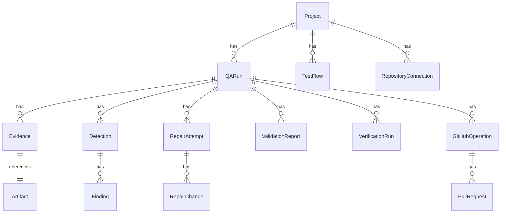

# Database Design (DB-1 Phase 2)

## Schema mapping
Existing entities in `app/db_models.py`: Project, QARun, TargetEnvironment, TestFlow, TestFlowVersion, Evidence, Artifact, Detection, Finding, RepairAttempt, RepairChange, ValidationReport, VerificationRun, GitHubOperation, PullRequest, WorkflowEvent, RepositoryConnection.

## Mermaid ER diagram


## Storage architecture
- Private Supabase Storage buckets: scan-artifacts, repair-artifacts, validation-artifacts.
- Object path: org/project/scan/<id>/<artifact>.png
- Metadata + exact path + checksum in PostgreSQL (Artifact table). No large blobs in DB.

## Authorization
- FastAPI local-owner auth protects routes. DB accessed server-side with service role key. RLS optional for client-side; not used here.

## Connection strategy
- Direct/session pooler for Alembic migrations; app may use transaction pooler with `prepare_threshold=None` for psycopg.

## Migration plan
- Existing Alembic migrations in `backend/migrations/versions/`. Run `alembic upgrade head`.
- No destructive changes; additive only.

## Conflicts
- In-memory fallback stores (ScanStore, etc.) coexist; DB path used when DATABASE_URL set.
- AttemptStore is process-wide in-memory; not yet persisted to DB (future work).
```
